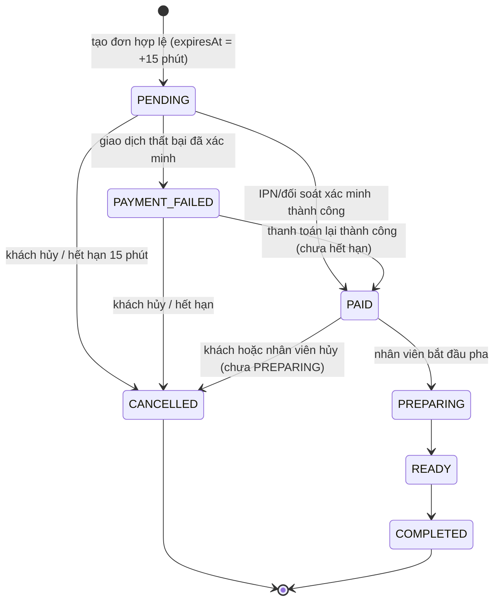
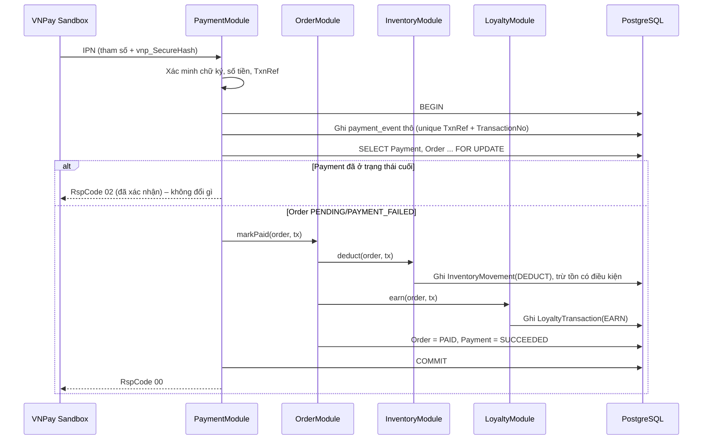

# Task 3.1 – Mô tả kiến trúc hệ thống BrewLite

> **Dự án:** BrewLite – Assignment 2
> **Người thực hiện:** Trần Đăng Khoa (`@khoadangtran141006-svg`)
> **Người review:** Nguyễn Minh Hiển (`@mhien06`)
> **Nhánh:** `docs/task3-architecture` → `develop`
> **Trạng thái:** Bản nháp chờ review. Các điểm đánh dấu **[Đề xuất]** là quyết định thiết kế do Task 3.1 đưa ra cho những điểm còn mở ở mục 8 của `docs/requirements/context-and-scope.md`; nhóm cần xác nhận khi review.

## 1. Mục đích và phạm vi

Tài liệu mô tả kiến trúc BrewLite dựa trên **Next.js (PWA)**, **NestJS** và **PostgreSQL**, tích hợp **VNPay Sandbox** làm dịch vụ thanh toán bên ngoài. Tài liệu là đầu vào cho Task 4–5 (hiện thực, kiểm thử, triển khai) và được viết thống nhất với `docs/requirements/context-and-scope.md` (Task 1.1).

Ngoài phạm vi tài liệu này: deployment diagram và lựa chọn nền tảng triển khai (Task 3.2), đặc tả chi tiết từng yêu cầu (SRS – Task 1.2), sơ đồ Activity/Sequence/Class (Task 2). Tài liệu chỉ tham chiếu các phần đó khi cần.

## 2. Phương pháp trình bày

Kiến trúc được trình bày bằng **C4 model** kết hợp **kiến trúc phân lớp** bên trong backend:

| Mức | Nội dung | Sơ đồ (nguồn `.drawio` → bản xuất `.svg`) |
|---|---|---|
| C4 – Level 1 System Context | BrewLite, người dùng và VNPay Sandbox | `docs/diagrams/sources/c4-context.drawio` → `docs/diagrams/c4-context.svg` |
| C4 – Level 2 Container | Web App, API, PostgreSQL | `docs/diagrams/sources/c4-container.drawio` → `docs/diagrams/c4-container.svg` |
| C4 – Level 3 Component | Các module của NestJS API | `docs/diagrams/sources/component-api.drawio` → `docs/diagrams/component-api.svg` |

Level 4 (code) không vẽ riêng; cấu trúc code được ánh xạ ở mục 11.

**Lý do chọn:** C4 cho phép người đọc đi từ bối cảnh đến chi tiết mà không bị lẫn mức trừu tượng; kiến trúc phân lớp (Controller → Service/Application → Persistence) bên trong từng module giúp tách rõ giao tiếp HTTP, nghiệp vụ và truy cập dữ liệu, thuận lợi cho unit test và integration test (Task 5.2).

## 3. Các động lực kiến trúc (Architectural Drivers)

Rút ra từ Task 1.1:

| # | Động lực | Hệ quả thiết kế chính |
|---|---|---|
| D1 | Chỉ ghi giảm nguyên liệu và cộng điểm **một lần** khi thanh toán được xác minh | Transaction + khóa dòng + ràng buộc unique trên sổ cái (mục 6, ADR-006, ADR-005) |
| D2 | Đơn `PENDING` chờ tối đa **15 phút** từ lúc tạo | Scheduler + `expiresAt` trên đơn (mục 7, ADR-007) |
| D3 | IPN có thể gửi trùng/đến muộn; kết quả UNKNOWN không được coi là thất bại | Idempotency nhiều lớp, đối soát `querydr`, tách trạng thái đơn và trạng thái giao dịch (mục 5, 6, 7) |
| D4 | VNPay Sandbox nằm **ngoài** ranh giới BrewLite | Cổng thanh toán đóng gói trong một adapter duy nhất (`VNPayGateway`), không rải logic VNPay ra module khác (ADR-004) |
| D5 | Hủy hợp lệ trước khi pha: hoàn nguyên liệu đúng một lần, điều chỉnh/bù điểm | Sổ cái kho và sổ cái điểm bất biến, thao tác đảo (mục 6.4, ADR-008) |
| D6 | Mobile-first/PWA, triển khai bằng Docker, có CI/CD | Web App tách riêng, API không trạng thái, cấu hình qua biến môi trường (mục 8, ADR-010) |
| D7 | Truy vết và kiểm thử được | Module theo domain, ranh giới rõ, health check, log có correlation-id |

## 4. C4 Level 1 và Level 2

### 4.1. System Context (`c4-context.svg`)

- **Người dùng:** Khách hàng, Nhân viên quầy, Quản lý cửa hàng – cùng dùng một Web App, khác nhau ở quyền (RBAC).
- **BrewLite:** hệ thống đang xây dựng, bao gồm Web App, API và cơ sở dữ liệu.
- **VNPay Sandbox:** hệ thống ngoài, chỉ thử nghiệm, không xử lý tiền thật. BrewLite gọi VNPay để tạo URL thanh toán đã ký và truy vấn giao dịch; VNPay gọi lại BrewLite qua **IPN** (server-to-server). Trình duyệt của khách được chuyển sang cổng VNPay rồi quay về **Return URL** (chỉ để hiển thị).

### 4.2. Container (`c4-container.svg`)

| Container | Công nghệ | Trách nhiệm | Giao tiếp |
|---|---|---|---|
| Web App | Next.js (App Router), PWA (manifest + service worker cho tài nguyên tĩnh) | Giao diện mobile-first: menu, chi tiết sản phẩm, giỏ hàng, đơn, trang kết quả thanh toán, màn hình nhân viên/quản lý. Giỏ hàng giữ ở phía client; số tiền hiển thị chỉ mang tính **tạm tính** | HTTPS → API (REST/JSON, JWT Bearer) |
| API | NestJS (Node.js) – modular monolith | Toàn bộ nghiệp vụ: xác thực, menu, báo giá, đơn, thanh toán, kho, điểm, scheduler, health | TCP 5432 → PostgreSQL; HTTPS ↔ VNPay Sandbox |
| PostgreSQL | PostgreSQL + Prisma Migrate | Nguồn dữ liệu duy nhất: người dùng, sản phẩm, công thức, đơn, giao dịch, kho, điểm, idempotency | Chỉ API truy cập (mạng nội bộ) |

**Mô tả các thành phần công nghệ**

- **Frontend Next.js/PWA.** PWA cho phép cài lên màn hình chính và cache tài nguyên tĩnh. **Không** hỗ trợ đặt đơn/thanh toán offline vì kết quả phụ thuộc xác minh phía server. Trang Return URL chỉ đọc kết quả bằng cách gọi API lấy trạng thái đơn (có thể polling ngắn), không tự quyết định thanh toán thành công.
- **Backend NestJS.** Một tiến trình, chia module theo domain (mục 5). Chọn modular monolith thay vì microservices vì quy mô nhóm/bài tập nhỏ, cần transaction ACID xuyên Order–Inventory–Loyalty (ADR-002).
- **PostgreSQL.** Nguồn sự thật duy nhất; dùng transaction, `SELECT … FOR UPDATE`, ràng buộc unique và CHECK để bảo vệ tính nhất quán (ADR-003).
- **VNPay Sandbox.** Hệ thống ngoài; mọi kết quả thanh toán chỉ được tin sau khi API **xác minh chữ ký HMAC, số tiền, mã đơn** (ADR-004).

## 5. C4 Level 3 – Module của API (`component-api.svg`)

### 5.1. Phân lớp bên trong mỗi module

1. **Presentation:** Controller, DTO (`class-validator`), Guard/Pipe/ExceptionFilter. Không chứa nghiệp vụ.
2. **Application/Domain:** Service chứa quy tắc nghiệp vụ (state machine, tính giá, quy tắc điểm…). Quản lý ranh giới transaction.
3. **Persistence:** truy cập DB qua `PrismaService`; mọi ghi quan trọng nằm trong transaction.

Quy tắc phụ thuộc: Controller → Service → Persistence; module chỉ gọi module khác qua Service được export, không truy cập bảng của module khác.

### 5.2. Trách nhiệm module

| Module | Trách nhiệm chính | Phụ thuộc |
|---|---|---|
| `AuthModule` | Đăng ký, đăng nhập, phát hành/kiểm tra JWT, RBAC Customer/Staff/Manager | – |
| `ProductModule` | Menu, chi tiết sản phẩm, size, topping, công thức nguyên liệu | – |
| `CartModule` | Báo giá và kiểm tra giỏ phía server (tính lại giá, kiểm tra sản phẩm/topping còn bán). Giỏ hàng lưu ở client; **số tiền chính thức luôn do backend tính lại khi tạo đơn** | Product, Promotion |
| `PromotionModule` | Mã giảm giá và điều kiện áp dụng; ghi nhận việc dùng mã | – |
| `OrderModule` | Tạo đơn, state machine, hủy đơn, lịch sử, màn hình nhân viên. **Điều phối transaction** đổi trạng thái kèm trừ/hoàn kho và cộng/hoàn điểm | Product, Cart, Promotion, Inventory, Loyalty |
| `PaymentModule` | `VNPayGateway` (ký URL, xác minh chữ ký), endpoint IPN và Return, idempotency, sổ cái giao dịch, `querydr` | Order |
| `InventoryModule` | Tồn kho nguyên liệu, trừ/hoàn theo công thức, `InventoryMovement` | – |
| `LoyaltyModule` | Cộng/hoàn/bù điểm BrewLite, `LoyaltyTransaction` (sổ cái) | – |
| `SchedulerModule` | Tác vụ định kỳ: hủy đơn `PENDING` quá hạn, đối soát giao dịch UNKNOWN | Order, Payment |
| `HealthModule`, `ConfigModule`, logger, filter, guard | Cắt ngang (cross-cutting), xem mục 8 | – |

## 6. Thiết kế xử lý nghiệp vụ nhạy cảm

### 6.1. Tách hai vòng đời: trạng thái đơn và trạng thái giao dịch

Không dùng một enum cho hai vòng đời (xem mục 8 của Task 1.1).

Trạng thái giao dịch (`Payment.status`): `INITIATED → SUCCEEDED | FAILED | UNKNOWN`. `UNKNOWN` (timeout, VNPay chưa trả kết quả rõ ràng) **không** được coi là thất bại; chỉ đối soát mới chuyển sang trạng thái cuối. Tên các trạng thái sau `PREPARING` (`READY`, `COMPLETED`) là **[Đề xuất]**, thống nhất lại với SRS.

### 6.2. Transaction khi thanh toán thành công

Khi API xác minh một giao dịch thành công (từ IPN hoặc từ đối soát `querydr`), thực hiện **một transaction duy nhất** (`READ COMMITTED` + khóa dòng):

Nguyên tắc:

1. **Tất cả hoặc không gì cả:** đổi trạng thái đơn, trừ kho, cộng điểm, cập nhật giao dịch nằm cùng một transaction; lỗi ở bước nào thì rollback toàn bộ.
2. **Trừ kho có điều kiện:** `UPDATE ingredient SET stock = stock - :qty WHERE id = :id AND stock >= :qty`; nếu 0 dòng bị ảnh hưởng nghĩa là thiếu nguyên liệu.
3. **Đúng một lần:** unique `(orderId, ingredientId, type)` trên `InventoryMovement` và unique `(orderId, type)` trên `LoyaltyTransaction` – lần thứ hai bị DB từ chối dù logic tầng ứng dụng sai sót.
4. **Công thức cộng điểm thông thường** do `LoyaltyModule` đóng gói trong một hàm duy nhất; công thức do nhóm chốt trong SRS (đang mở ở Task 1.1).

**Ngoại lệ – kết quả IPN thành công đến khi đơn không còn hợp lệ [Đề xuất]:**

| Tình huống | Xử lý |
|---|---|
| Đơn đã `CANCELLED`/hết hạn nhưng VNPay báo thành công (IPN đến muộn) | Ghi `Payment = SUCCEEDED`, **không** chuyển đơn về `PAID`, không trừ kho; tạo `LoyaltyTransaction(COMPENSATION)` bù theo 1 điểm = 100 VNĐ (làm tròn lên), idempotent theo `paymentId`; log mức `WARN` kèm correlation-id để đối chiếu |
| Thanh toán thành công nhưng **thiếu nguyên liệu** khi trừ kho | Rollback phần trừ kho; trong transaction mới: `Payment = SUCCEEDED`, đơn → `CANCELLED` với lý do `INSUFFICIENT_STOCK`, bù điểm như trên |
| Hủy và thanh toán xảy ra đồng thời | Cả hai thao tác đều `SELECT … FOR UPDATE` đơn; thao tác nào lấy khóa trước thắng, thao tác sau đọc trạng thái mới và xử lý theo bảng trên |

### 6.3. Idempotency và kiểm soát xử lý trùng (nhiều lớp)

| Lớp | Cơ chế | Chống lại |
|---|---|---|
| Yêu cầu HTTP từ client | Header `Idempotency-Key` cho `POST /orders`, `POST /payments/vnpay/create`, hủy đơn; bảng `idempotency_key` unique `(userId, key)`, lưu `requestHash` và phản hồi đã trả | Bấm hai lần, gửi lại khi mạng chậm |
| Giao dịch VNPay | `vnp_TxnRef` duy nhất cho mỗi lần thử thanh toán; unique trên `Payment.txnRef` | Hai URL thanh toán trùng mã |
| Thông báo IPN | Lưu bản ghi thô `payment_event` unique `(txnRef, transactionNo)`; nếu `Payment` đã ở trạng thái cuối thì trả `RspCode 02` và không đổi gì | IPN gửi lại |
| Tranh chấp đồng thời | `SELECT … FOR UPDATE` trên `Order` và `Payment` trong transaction | IPN và scheduler/hủy chạy cùng lúc |
| Hiệu ứng phụ | Unique trên `InventoryMovement` và `LoyaltyTransaction` | Trừ kho/cộng điểm/bù điểm lặp |

Return URL **không** thay đổi trạng thái đơn.

### 6.4. Hủy đơn, hoàn nguyên liệu và bù điểm

Điều kiện hủy theo Task 1.1 (khách: `PENDING`/`PAYMENT_FAILED`/`PAID`; nhân viên: `PAID` kèm lý do; từ `PREPARING` trở đi không hủy). Việc kiểm tra điều kiện và thao tác nằm trong **một transaction** có khóa dòng đơn, nên hủy và "bắt đầu pha" đồng thời chỉ một bên thắng.

| Đơn bị hủy khi | Kho | Điểm |
|---|---|---|
| `PENDING` / `PAYMENT_FAILED` | Không có gì để hoàn (chưa trừ) | Hoàn lại điểm khách đã dùng để giảm giá (nếu có): `LoyaltyTransaction(REDEEM_REVERSAL)` |
| `PAID` | Với mỗi `InventoryMovement(DEDUCT)` của đơn, ghi `InventoryMovement(RESTORE)` đúng lượng đã trừ và cộng lại tồn; unique `(orderId, ingredientId, type)` đảm bảo **hoàn một lần** | Thu hồi điểm đã cộng: `EARN_REVERSAL`; trả điểm đã dùng: `REDEEM_REVERSAL`; **bù giá trị VNPay**: `COMPENSATION = ceil(số tiền VNPay đã trả / 100)` |

Điểm bù là quyền lợi trong BrewLite, **không** phải tiền hoàn về VNPay. Bản ghi `COMPENSATION` có khóa đối chiếu theo `paymentId`, để nếu còn yêu cầu hoàn tiền VNPay cũ trong dữ liệu thì hệ thống phát hiện và không bù/hoàn hai lần (rủi ro đã nêu ở Task 1.1). Việc cho phép hay chặn số dư điểm âm khi đã tiêu điểm vừa được cộng là điểm cần nhóm chốt (mục 10).

## 7. Scheduler xử lý đơn `PENDING` quá 15 phút và đối soát VNPay

`SchedulerModule` (dùng `@nestjs/schedule`) chạy trong tiến trình API.

**Job 1 – Hết hạn đơn (mỗi 1 phút):**

1. Trong transaction: chọn đơn `PENDING`/`PAYMENT_FAILED` có `expiresAt <= now()` bằng `FOR UPDATE SKIP LOCKED` (giới hạn theo lô) – an toàn khi chạy nhiều bản API.
2. Với mỗi đơn có `Payment` ở `INITIATED`/`UNKNOWN`: **không hủy ngay**, gọi `querydr` (Job 2).
3. Đơn không có giao dịch đang chờ, hoặc `querydr` xác nhận thất bại/không tồn tại: `CANCELLED` (lý do `EXPIRED`), hoàn điểm đã dùng nếu có (không hoàn kho vì chưa trừ).
4. `querydr` xác nhận thành công: xử lý như IPN thành công (mục 6.2).

**Job 2 – Đối soát giao dịch UNKNOWN (mỗi vài phút, backoff):**

- Gọi `querydr` cho các `Payment` quá một ngưỡng thời gian không nhận IPN hoặc có trạng thái `UNKNOWN`; kết quả được xử lý **qua cùng một hàm xử lý kết quả giao dịch** với IPN, nên idempotent.
- Lỗi mạng/timeout từ VNPay: giữ `UNKNOWN`, thử lại lần sau, đánh dấu cần kiểm tra thủ công nếu vượt ngưỡng thử lại **[Đề xuất: ngưỡng cụ thể do nhóm chốt]**.

Đơn không bao giờ bị hủy chỉ vì "hết giờ" khi kết quả giao dịch còn chưa xác định (rủi ro đã nêu ở Task 1.1). Chi tiết lựa chọn ở ADR-007.

## 8. Dữ liệu, migration, logging, health check, cấu hình và secret

### 8.1. PostgreSQL và migration

- Migration bằng **Prisma Migrate**; file migration được commit trong `apps/api`, chạy tự động bằng một bước riêng trước khi khởi động bản API mới (Task 5.3 – "chạy migration an toàn"). Migration phải tương thích ngược một phiên bản (expand → migrate → contract) để rollback ứng dụng không làm hỏng dữ liệu.
- Seed dữ liệu mẫu có thể chạy lại để tái tạo database (Task 4.3, 5.2).
- Bảng chính (tham chiếu Class diagram ở Task 2.3): `User`, `Product`, `ProductSize`, `Topping`, `Ingredient`, `Recipe`, `Order`, `OrderItem`, `Payment`, `PaymentEvent`, `InventoryMovement`, `Promotion`, `LoyaltyTransaction`, `IdempotencyKey`.
- Tiền VND lưu dạng số nguyên (đơn vị đồng), không dùng số thực.

### 8.2. Logging

- Log **JSON có cấu trúc** (Pino) ra stdout; nền tảng triển khai thu thập log.
- Mỗi request có `correlationId` (nhận từ header hoặc tự sinh) gắn vào mọi dòng log và phản hồi lỗi.
- Log sự kiện nghiệp vụ quan trọng: đổi trạng thái đơn, kết quả xác minh IPN, đối soát, hoàn kho, bù điểm.
- **Không** log secret, token, `vnp_SecureHash`, mật khẩu; che các trường nhạy cảm.

### 8.3. Health check

- `GET /health`: liveness (tiến trình còn sống, không phụ thuộc DB).
- `GET /health/ready`: readiness (kiểm tra kết nối PostgreSQL), dùng cho smoke test sau triển khai và cho nền tảng.

### 8.4. Quản lý cấu hình và secret

- Toàn bộ cấu hình qua **biến môi trường**, đọc bằng `ConfigModule` và **validate lúc khởi động** (thiếu hoặc sai kiểu thì dừng ngay).
- `.env.example` liệt kê tên biến, không chứa giá trị thật. Ví dụ: `DATABASE_URL`, `JWT_SECRET`, `JWT_EXPIRES_IN`, `VNP_TMN_CODE`, `VNP_HASH_SECRET`, `VNP_PAY_URL`, `VNP_API_URL`, `VNP_RETURN_URL`, `ORDER_PENDING_TTL_MINUTES`, `WEB_ORIGIN`.
- Secret thật chỉ nằm trong biến môi trường của máy local, secret store của CI và nền tảng production; không commit, không in ra log CI.
- CORS chỉ cho phép `WEB_ORIGIN`; HTTPS bắt buộc ở production (Task 3.2 mô tả chi tiết hạ tầng).

## 9. Ưu điểm, hạn chế và trade-off

| Quyết định | Ưu điểm | Hạn chế | Trade-off chấp nhận |
|---|---|---|---|
| Modular monolith | Transaction ACID xuyên module, triển khai/gỡ lỗi đơn giản, hợp quy mô nhóm | Không scale từng module độc lập; phải giữ kỷ luật ranh giới module | Ưu tiên tính nhất quán và tốc độ hoàn thành hơn khả năng scale riêng lẻ |
| Scheduler chạy trong API | Ít thành phần, đủ cho quy mô bài tập | Nhiều bản API cùng chạy cron; job nặng ảnh hưởng API | Dùng `SKIP LOCKED` để an toàn; có thể tách worker sau |
| Idempotency nhiều lớp bằng DB | Đúng ngay cả khi code ứng dụng có lỗi | Thêm bảng, ràng buộc, code xử lý lỗi unique | Chấp nhận phức tạp hơn để tránh sai tiền/kho/điểm |
| Tin IPN/`querydr`, không tin Return URL | An toàn trước giả mạo trình duyệt | Người dùng phải chờ/poll để thấy kết quả | Ưu tiên đúng đắn hơn phản hồi tức thì |
| Bù bằng điểm thay vì hoàn tiền VNPay | Không cần luồng hoàn tiền tự động | Khách nhận điểm thay vì tiền | Theo phạm vi đã chốt ở Task 1.1 |
| PWA không offline cho checkout | Tránh trạng thái không nhất quán | Mất mạng thì không đặt đơn được | Phù hợp nghiệp vụ cần xác minh server |
| Giỏ hàng ở client + báo giá server | Giảm tải server, UX nhanh | Hai nơi cùng tính tiền | Server tính lại là chuẩn, client chỉ tạm tính |

## 10. Điểm cần nhóm xác nhận khi review

1. Công thức tích điểm thưởng thông thường và quy tắc làm tròn (đang mở từ Task 1.1).
2. Xử lý IPN thành công đến muộn và trường hợp thiếu nguyên liệu như bảng ở mục 6.2 **[Đề xuất]**.
3. Cho phép hay chặn số dư điểm âm khi thu hồi điểm đã cộng mà khách đã tiêu.
4. Tên các trạng thái sau `PREPARING` và `PAYMENT_FAILED → PAID` (thanh toán lại) cho thống nhất với SRS/Class diagram.
5. Công cụ ORM/migration (Prisma) và thư viện logger (Pino) – ghi ở ADR-003, ADR-010; đổi được nếu nhóm đã chọn khác.
6. Chiến lược lưu JWT phía client (ADR-009).

## 11. Danh mục ADR

| ADR | Quyết định |
|---|---|
| [001](adr/001-monorepo.md) | Monorepo `apps/web`, `apps/api`, `docs` |
| [002](adr/002-modular-monolith-nestjs.md) | NestJS modular monolith theo domain, kiến trúc phân lớp |
| [003](adr/003-postgresql-prisma-migrations.md) | PostgreSQL + Prisma Migrate, tiền lưu số nguyên |
| [004](adr/004-vnpay-sandbox-integration.md) | Tích hợp VNPay Sandbox qua adapter; tin IPN/querydr, không tin Return URL |
| [005](adr/005-idempotency-and-duplicate-control.md) | Idempotency nhiều lớp và kiểm soát xử lý trùng |
| [006](adr/006-transactions-inventory-loyalty.md) | Transaction cho thanh toán thành công, trừ kho, tích điểm, hủy đơn |
| [007](adr/007-scheduler-expiry-reconciliation.md) | Scheduler hết hạn 15 phút và đối soát VNPay |
| [008](adr/008-loyalty-ledger-compensation.md) | Sổ cái điểm BrewLite, hoàn và bù điểm |
| [009](adr/009-jwt-authentication-rbac.md) | JWT và RBAC Customer/Staff/Manager |
| [010](adr/010-config-logging-health.md) | Cấu hình/secret, logging, health check |

## 12. Truy vết kiến trúc → mã nguồn

Cấu trúc đề xuất cho Task 4–5 (theo mục 9 của đề Assignment 2). Mã yêu cầu `FR-xx`/`NFR-xx` sẽ được điền vào `docs/traceability-matrix.md` khi SRS (Task 1.2) hoàn tất.

| Thành phần trong sơ đồ | Thư mục mã nguồn dự kiến |
|---|---|
| Web App (Next.js) | `apps/web/` |
| API (NestJS) | `apps/api/src/` |
| Auth, Product, Cart, Promotion, Order, Payment, Inventory, Loyalty, Scheduler, Health | `apps/api/src/<tên-module>/` |
| Cross-cutting (config, logger, filter, guard) | `apps/api/src/common/`, `apps/api/src/config/` |
| Persistence và migration | `apps/api/prisma/` (schema, migrations, seed) |
| PostgreSQL | dịch vụ `db` trong `docker-compose.yml` (local) |
| Kiểm thử tích hợp/E2E | `tests/` |

## 13. Liên hệ với các task khác

- **Task 1.2/1.3:** mỗi quyết định ở đây phải truy được về một `FR`/`NFR`; nếu SRS đổi quy tắc, cập nhật tài liệu này và ADR liên quan trong cùng PR.
- **Task 2:** Sequence diagram thanh toán và Class diagram phải khớp mục 6 và 8.1.
- **Task 3.2:** Deployment diagram tham chiếu các container ở mục 4.2 và các quy tắc cấu hình ở mục 8.4.
