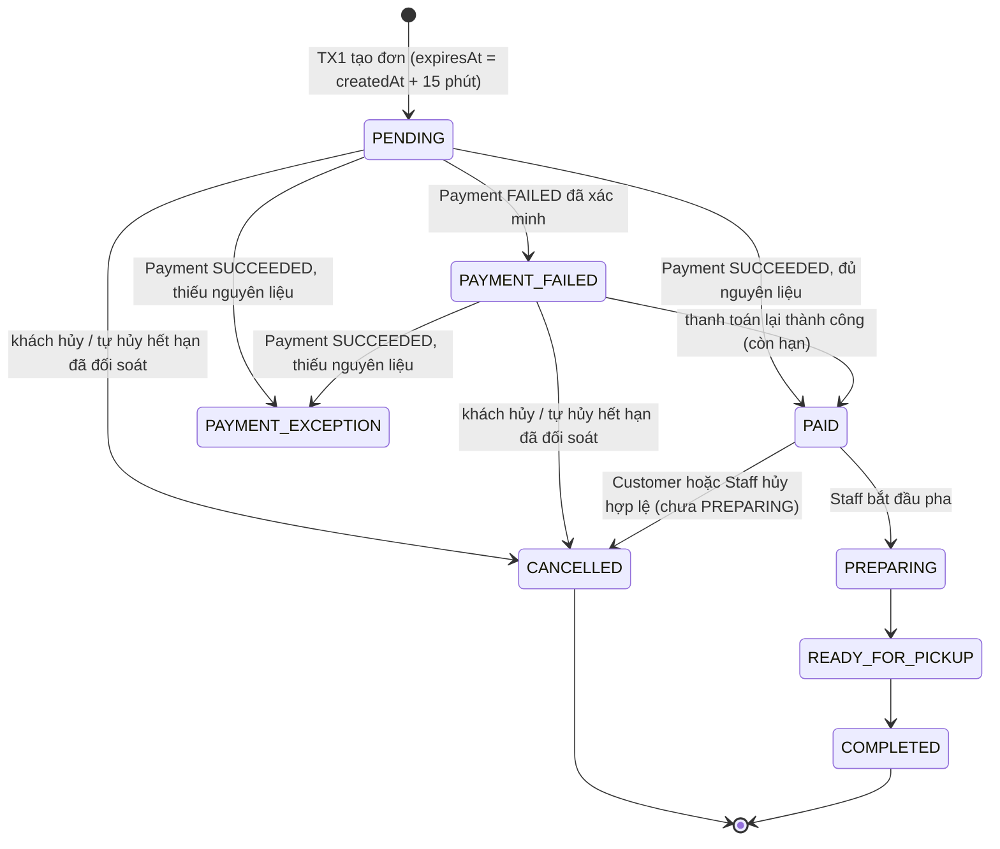
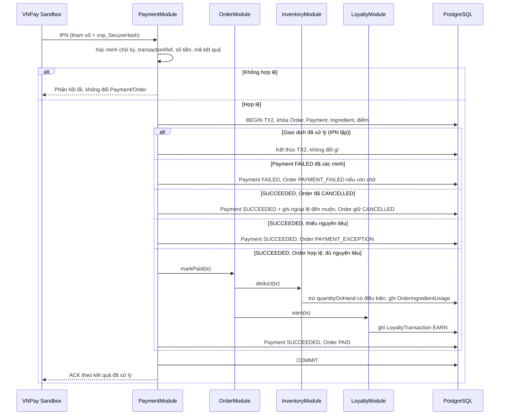

# Task 3.1 – Mô tả kiến trúc hệ thống BrewLite

> **Dự án:** BrewLite – Assignment 2
> **Người thực hiện:** Trần Đăng Khoa (`@khoadangtran141006-svg`)
> **Người review:** Nguyễn Minh Hiển (`@mhien06`)
> **Nhánh:** `docs/task3-architecture` → `develop` (Issue #7)
> **Tài liệu đầu vào (đã thống nhất trên `develop`):** [Bối cảnh & phạm vi](../requirements/context-and-scope.md), [SRS](../requirements/srs.md), [Use Case Checkout](../requirements/use-case-checkout.md), [Domain Class](../diagrams/domain-class.md), [Sequence Checkout](../diagrams/sequence-checkout.md)
> **Trạng thái:** Bản chờ review. Nội dung đánh dấu **[Đề xuất]** là quyết định thiết kế chưa được SRS/Task 2 chốt; không coi là quy tắc đã duyệt cho đến khi nhóm xác nhận (mục 11).

## 1. Mục đích và phạm vi

Tài liệu mô tả kiến trúc BrewLite dựa trên **Next.js (PWA)**, **NestJS** và **PostgreSQL**, tích hợp **VNPay Sandbox** là hệ thống ngoài (không nằm trong ranh giới BrewLite). Kiến trúc phải thỏa các yêu cầu trong SRS (FR-01–FR-26, NFR-01–NFR-10, BR-01–BR-13) và dùng **đúng tên** trạng thái, thực thể, loại giao dịch điểm đã thống nhất ở Task 1–2.

Ngoài phạm vi tài liệu này: Deployment diagram và nền tảng triển khai (Task 3.2), mã nguồn (Task 4–5). Tên endpoint nêu bên dưới chỉ mang tính minh họa thiết kế, như trong tài liệu Sequence.

## 2. Phương pháp trình bày

**C4 model** kết hợp **kiến trúc phân lớp** bên trong backend. Nguồn chỉnh sửa được là file `.drawio`; bản xuất `.svg` nằm trong `exports/` (cùng quy ước với các sơ đồ Task 1–2).

| Mức | Nội dung | Nguồn (`.drawio`) | Bản xuất (`.svg`) |
|---|---|---|---|
| C4 – Level 1 System Context | BrewLite, người dùng, VNPay Sandbox | [c4-context](../diagrams/sources/c4-context.drawio) | [c4-context](../diagrams/exports/c4-context.svg) |
| C4 – Level 2 Container | Web App, API, PostgreSQL | [c4-container](../diagrams/sources/c4-container.drawio) | [c4-container](../diagrams/exports/c4-container.svg) |
| C4 – Level 3 Component | Module của NestJS API | [component-api](../diagrams/sources/component-api.drawio) | [component-api](../diagrams/exports/component-api.svg) |

Level 4 (code) không vẽ; ánh xạ sang cấu trúc thư mục ở mục 12. Chạy `python tools/render_c4_diagrams.py` từ gốc repo để tạo lại cả `.drawio` và `.svg` từ cùng một mô tả; nếu sửa trực tiếp `.drawio` thì phải cập nhật script trước khi tái xuất.

**Lý do chọn:** C4 cho phép đi từ bối cảnh đến chi tiết mà không lẫn mức trừu tượng; phân lớp Controller → Service → Persistence trong từng module tách rõ giao tiếp HTTP, nghiệp vụ và dữ liệu, thuận lợi cho unit/integration test (NFR-09).

## 3. Động lực kiến trúc (Architectural Drivers)

| # | Động lực | Căn cứ | Hệ quả thiết kế |
|---|---|---|---|
| D1 | Trừ nguyên liệu, `EARN`, ghi `PAID` **đúng một lần**; không có `PAID` nửa chừng | FR-10, BR-02, NFR-04, E10 | TX2: một transaction + khóa dòng + ràng buộc unique (mục 6, ADR-005/006) |
| D2 | Order chờ tối đa **15 phút từ `createdAt`**; Payment attempt không vượt hạn Order; thanh toán lại không gia hạn | FR-07, BR-03 | `Order.expiresAt`, `Payment.expiresAt ≤ Order.expiresAt`, Scheduler (mục 7, ADR-007) |
| D3 | IPN lặp/đến muộn; `PENDING/UNKNOWN` không được coi là thất bại; Return URL không là bằng chứng | FR-09, FR-11–FR-13, BR-04 | Tách `OrderStatus` và `PaymentStatus`; QueryDR đối soát (mục 5.3, 7, ADR-004/011) |
| D4 | VNPay Sandbox nằm ngoài BrewLite, chỉ VNPay Sandbox | BR-01, FR-08 | Adapter `VNPayGateway` duy nhất (ADR-004) |
| D5 | Hủy hợp lệ trước pha: hoàn đúng `quantityDeducted` một lần, điều chỉnh/bù điểm, loại trừ refund VNPay cũ | FR-15–FR-20, BR-05–BR-09 | TX3, `OrderIngredientUsage`, `LoyaltyTransaction`, `VNPayRefundRecord` (mục 6.4, ADR-008) |
| D6 | Thanh toán thành công đến muộn (đơn `CANCELLED`) hoặc thiếu nguyên liệu | BR-11, BR-12, E08, E09 | Quy trình ngoại lệ + `PAYMENT_EXCEPTION` (mục 6.2, ADR-006/011) |
| D7 | Mobile-first/PWA, Docker, CI/CD, health, secret không lộ | NFR-05, NFR-07, NFR-03 | Mục 8, ADR-010 |
| D8 | Ghi vết và truy vết đến yêu cầu, sơ đồ, API, test | FR-26, NFR-08, NFR-10 | Log có correlation-id, bảng sự kiện, mục 12 |

## 4. C4 Level 1 và Level 2

### 4.1. System Context

- **Người dùng:** Customer, Staff, Manager dùng chung một Web App, khác nhau ở quyền (RBAC). Manager dùng được các chức năng vận hành của Staff (SRS §6).
- **BrewLite:** Web App + API + cơ sở dữ liệu.
- **VNPay Sandbox:** hệ thống ngoài, chỉ thử nghiệm. BrewLite tạo URL thanh toán đã ký và gọi QueryDR; VNPay gọi lại bằng **IPN** (server-to-server). Trình duyệt khách được chuyển sang VNPay rồi quay về **Return URL** (chỉ hiển thị).

### 4.2. Container

| Container | Công nghệ | Trách nhiệm | Giao tiếp |
|---|---|---|---|
| Web App | Next.js (App Router), PWA | Giao diện mobile-first: menu, chi tiết sản phẩm, giỏ, đơn, kết quả thanh toán (Return URL), màn hình Staff/Manager. Số tiền hiển thị chỉ là **tạm tính** | HTTPS → API (REST/JSON, JWT Bearer) |
| API | NestJS – modular monolith | Toàn bộ nghiệp vụ, Scheduler, health | TCP 5432 → PostgreSQL; HTTPS ↔ VNPay Sandbox |
| PostgreSQL | PostgreSQL + Prisma Migrate | Nguồn dữ liệu duy nhất (mục 8.1) | Chỉ API truy cập, mạng nội bộ |

- **Frontend Next.js/PWA.** Cài được lên màn hình chính, cache tài nguyên tĩnh. **Không** hỗ trợ thanh toán offline (SRS NFR-05). Trang Return URL chỉ đọc trạng thái do API đã xác minh (có thể polling ngắn), không tự quyết định `PAID`.
- **Backend NestJS.** Một tiến trình, chia module theo domain (mục 5). Chọn modular monolith vì cần transaction ACID xuyên Order–Inventory–Loyalty và nhóm nhỏ (ADR-002).
- **PostgreSQL.** Transaction, `SELECT … FOR UPDATE`, ràng buộc unique/CHECK bảo vệ tính nhất quán (ADR-003).
- **VNPay Sandbox.** Kết quả chỉ được tin sau khi xác minh **chữ ký, `transactionRef`, số tiền, mã kết quả** (FR-09, ADR-004).

## 5. C4 Level 3 – Module của API

### 5.1. Phân lớp bên trong mỗi module

1. **Presentation:** Controller, DTO (`class-validator`), Guard/Pipe/ExceptionFilter. Không chứa nghiệp vụ.
2. **Application/Domain:** Service chứa quy tắc nghiệp vụ và ranh giới transaction.
3. **Persistence:** truy cập DB qua `PrismaService`; mọi ghi quan trọng trong transaction.

Module chỉ gọi module khác qua Service được export; không truy cập bảng của module khác.

### 5.2. Trách nhiệm module (khớp thực thể của Domain Class)

| Module | Thực thể / trách nhiệm | FR chính | Phụ thuộc |
|---|---|---|---|
| `AuthModule` | `User` (`role`, `status`, `passwordHash`); đăng ký, đăng nhập, JWT, RBAC | FR-04 | – |
| `ProductModule` | `Product`, `ProductOption` (size/topping), `Recipe`, `RecipeIngredient`; quản lý menu/công thức cho Manager | FR-01, FR-02, FR-21, FR-25 | Inventory (đọc `Ingredient`) |
| `CartModule` | `Cart`, `CartItem` (lưu phía server, `estimatedUnitPrice` là giá tạm tính); kiểm tra giỏ và **báo giá** do backend tính lại | FR-03, FR-05 | Product |
| `OrderModule` | `Order`, `OrderItem` (snapshot), `OrderCancellation`; state machine; điều phối **TX1** (tạo đơn) và **TX3** (hủy); màn hình Staff chuyển trạng thái | FR-05–FR-07, FR-15–FR-17, FR-23, FR-24 | Cart, Product, Inventory, Loyalty |
| `PaymentModule` | `Payment` (attempt), `VNPayRefundRecord`; `VNPayGateway` (ký URL, xác minh chữ ký, QueryDR); endpoint IPN/Return; điều phối **TX2** | FR-08–FR-14, FR-19, FR-20 | Order |
| `InventoryModule` | `Ingredient` (`quantityOnHand`), `OrderIngredientUsage` (trừ/hoàn đúng lượng đã trừ) | FR-10, FR-17, FR-21 | – |
| `LoyaltyModule` | `LoyaltyTransaction` (ledger), `User.pointsBalance`; `REDEEM`, `EARN`, `RETURN_REDEEMED`, `REVERSE_EARNED`, `VNPAY_COMPENSATION`, `ADJUST` | FR-10, FR-18, FR-19, FR-22 | – |
| `SchedulerModule` | Đối soát QueryDR cho Payment `PENDING/UNKNOWN`, đánh dấu `EXPIRED`, tự hủy Order chưa `PAID` hết hạn | FR-13 | Order, Payment |
| `PromotionModule` `«future»` | **Chưa thuộc MVP**: SRS không có FR cho khuyến mãi; `Order.discountAmount = 0` | – | – |
| Cross-cutting | `ConfigModule`, logger, filter, guard, `HealthModule` (mục 8) | NFR-03, NFR-07, NFR-08 | – |

### 5.3. Hai vòng đời tách biệt

Trạng thái đơn **không** chứa kết quả thanh toán; kết quả giao dịch chỉ nằm ở `Payment.status` (BR-13).

- `PAID` **không** tự hủy sau 15 phút. `PAYMENT_EXCEPTION` không tự hủy theo `expiresAt`, không sang `PREPARING`, giữ nguyên sau khi bù điểm (Domain Class §5, §11). Cách kết thúc `PAYMENT_EXCEPTION` chưa được SRS quy định (mục 11).
- Từ `PREPARING` trở đi không hủy được; `CANCELLED` không mở lại (BR-06, BR-11).

| `Payment.status` | Ý nghĩa | Cho tạo Payment mới |
|---|---|---|
| `PENDING` | Đã tạo, chưa có kết quả đáng tin cậy | Không |
| `UNKNOWN` | Chưa xác định (IPN chậm/không đến, lỗi mạng) | Không |
| `SUCCEEDED` | Đã xác minh chữ ký, mã tham chiếu, số tiền, mã kết quả | Không |
| `FAILED` | Thất bại đã xác minh | Có, nếu Order còn hạn |
| `EXPIRED` | Quá `Payment.expiresAt`, đã kiểm tra không có kết quả thành công | Có, nếu Order còn hạn |

Mỗi Order có tối đa một Payment `SUCCEEDED`.

## 6. Thiết kế xử lý nghiệp vụ nhạy cảm

Ba transaction đặt tên đúng như tài liệu Sequence: **TX1** tạo đơn, **TX2** xử lý kết quả thanh toán, **TX3** hủy đơn. Mọi lỗi ghi/commit trong TX thì **rollback toàn bộ** và không trả kết quả thành công.

### 6.1. TX1 – Tạo đơn

1. Báo giá: backend xác thực JWT/quyền Customer, đọc giá, tùy chọn, công thức, nguyên liệu, số dư điểm và **tính lại toàn bộ giá** (FR-05); kho lúc này chỉ là kiểm tra.
2. `POST /orders`: `BEGIN` → khóa số dư điểm, đọc lại giá/kho → kiểm tra giá khách đã xác nhận → lưu `Order(PENDING)` + `OrderItem` snapshot, `expiresAt = createdAt + 15 phút` theo đồng hồ server → nếu dùng điểm: ghi `REDEEM` và giảm số dư nguyên tử, không vượt số dư → `COMMIT`. **Không trừ/giữ nguyên liệu** (FR-06, BR-02).
3. `vnpayPayableAmount = totalAmount − pointsDiscountAmount`, không âm **[Đề xuất – Domain Class §12.1]**; `Payment.amount` phải bằng giá trị này khi xác minh.
4. Ghi `REDEEM` ngay ở TX1, trả lại đúng một lần khi hủy/ngoại lệ kết thúc **[Đề xuất – Sequence]**.

### 6.2. TX2 – Xử lý kết quả thanh toán (IPN hoặc QueryDR, dùng chung một hàm)

Nguyên tắc:

1. **Nguyên tử:** đổi trạng thái Payment/Order, trừ kho, `EARN` cùng một transaction; lỗi thì rollback, **không** ACK thành công để VNPay/QueryDR còn retry, và giữ dấu vết yêu cầu đã xác minh (E10).
2. **Trừ kho có điều kiện:** `UPDATE ingredient SET quantity_on_hand = quantity_on_hand - :q WHERE id = :id AND quantity_on_hand >= :q`; 0 dòng bị ảnh hưởng nghĩa là thiếu nguyên liệu. Lượng trừ được lưu vào `OrderIngredientUsage.quantityDeducted` cùng snapshot đơn vị/tên.
3. **`EARN`:** tính theo chính sách tích điểm trên **tiền VNPay thực trả**, không trên phần giảm bằng điểm (FR-10). Tỷ lệ **chưa được chốt** (SRS §8), đóng gói trong một hàm của `LoyaltyModule`.
4. **Đúng một lần:** unique trên `OrderIngredientUsage` theo `(orderItemId, ingredientId)` và trên `LoyaltyTransaction.idempotencyKey`.

**Hai ngoại lệ (BR-11, BR-12; E08, E09):**

| Tình huống | Payment | Order | Kho / `EARN` | Bước tiếp theo |
|---|---|---|---|---|
| Thành công **đến muộn**, Order đã `CANCELLED` | `SUCCEEDED` + ghi ngoại lệ đến muộn | Giữ `CANCELLED`, không mở lại | Không trừ kho, không `EARN` | Đối soát bù điểm (bên dưới) |
| Thành công nhưng **thiếu nguyên liệu** | `SUCCEEDED` | `PAYMENT_EXCEPTION` (không `PAID`) | Không trừ kho, không `EARN` | Đối soát bù điểm (bên dưới) |

**Đối soát bù điểm (transaction riêng, khóa Order/Payment/điểm, tra `VNPayRefundRecord` và ledger):**

| Điều kiện | Kết quả |
|---|---|
| Refund VNPay cũ `PENDING`/`UNKNOWN` | Ghi chờ đối soát, **khóa cấp điểm bù** (FR-20) |
| Refund cũ `SUCCEEDED`, hoặc Payment đã được bù | Không cấp quyền lợi trùng |
| Không có refund thành công/đang xử lý và chưa bù | `VNPAY_COMPENSATION = ceil(VNPay thực trả / 100)` gắn `paymentId`; trả `REDEEM` chưa hoàn qua `RETURN_REDEEMED` khi kết thúc đơn |
| Refund cũ `FAILED` | **Chưa quy định** (Domain Class §12.4) – cần nhóm chốt |

Mỗi bước có khóa nghiệp vụ duy nhất (`idempotencyKey`), nên rollback rồi retry an toàn.

### 6.3. Idempotency và kiểm soát xử lý trùng (nhiều lớp, khóa nằm trên thực thể)

| Lớp | Cơ chế | Chống lại |
|---|---|---|
| Tạo Payment attempt | Header `Idempotency-Key` lưu ở `Payment.idempotencyKey` (unique) cùng hash nội dung. **Cùng key + cùng nội dung** → trả lại kết quả cũ, không tạo attempt mới; **cùng key khác nội dung** → từ chối (`409`) (FR-12, A05) | Bấm hai lần, gửi lại khi mạng chậm |
| Điều kiện tạo attempt mới | Order còn hạn **và** mọi attempt trước đã kết thúc rõ (`FAILED`/`EXPIRED`); có attempt `PENDING`/`UNKNOWN` thì không tạo, trả "Đang xác minh" (E06) | Hai lượt thanh toán cạnh tranh |
| Giao dịch VNPay | `Payment.transactionRef` duy nhất | Trùng mã tham chiếu |
| IPN / QueryDR lặp | Payment đã xử lý thì chỉ ACK; cùng hàm TX2 cho cả IPN và QueryDR | Xử lý lặp |
| Hủy đơn | `OrderCancellation.idempotencyKey`; mỗi Order tối đa một `OrderCancellation` | Hủy lặp |
| Hoàn kho | `OrderIngredientUsage.restoreIdempotencyKey`, ràng buộc `quantityRestored ≤ quantityDeducted` | Hoàn kho nhiều lần |
| Điểm | `LoyaltyTransaction.idempotencyKey` unique; unique `(paymentId, VNPAY_COMPENSATION)` | Cộng/hoàn/bù điểm lặp |
| Đồng thời | `SELECT … FOR UPDATE` Order/Payment trong TX | IPN, Scheduler, hủy, bắt đầu pha chạy cùng lúc (E11) |

Domain model **không** có `idempotencyKey` trên `Order`; nguy cơ tạo trùng đơn khi bấm đúp được giảm bằng bước "xác nhận giá" ở UI và chống submit lặp, và là điểm cần nhóm xem lại (mục 11).

### 6.4. TX3 – Hủy đơn, hoàn nguyên liệu và điểm

`POST /orders/:id/cancel` (JWT, key, lý do). Kiểm quyền: Customer chỉ hủy đơn **của mình** khi `PENDING`/`PAYMENT_FAILED`/`PAID` chưa pha; Staff chỉ hủy `PAID` chưa pha và **bắt buộc có lý do** (FR-15, FR-16). Từ `PREPARING` trở đi: từ chối. Thao tác bắt đầu pha dùng cùng khóa Order nên **chỉ một bên thắng** (FR-24).

| Đơn bị hủy khi | Nguyên liệu | Điểm |
|---|---|---|
| `PENDING` / `PAYMENT_FAILED` (đã xác nhận chưa trả tiền) | Không hoàn (`OrderIngredientUsage` rỗng) | `RETURN_REDEEMED` cho `REDEEM` chưa hoàn |
| Có Payment `PENDING`/`UNKNOWN` | Chưa hủy: lưu yêu cầu chờ đối soát, gọi QueryDR **ngoài transaction giữ khóa**, rồi chạy lại TX3 | – |
| `PAID` chưa pha | Hoàn đúng `quantityDeducted` đã lưu (**không** tính lại từ Recipe hiện tại), ghi `quantityRestored`, `restoredAt` | `RETURN_REDEEMED` + `REVERSE_EARNED`; **bù** `VNPAY_COMPENSATION = ceil(VNPay thực trả / 100)` nếu qua kiểm tra refund cũ (bảng ở mục 6.2) |

`OrderCancellation` ghi người hủy, vai trò, lý do, `isAutomatic`, `cancelledAt`. Điểm bù là quyền lợi trong BrewLite, **không** phải tiền hoàn về VNPay (BR-08). Cho phép hay chặn `pointsBalance` âm khi thu hồi `EARN` đã tiêu là điểm cần nhóm chốt (mục 11).

## 7. Scheduler: hết hạn 15 phút và đối soát VNPay

`SchedulerModule` (`@nestjs/schedule`) chạy trong tiến trình API, hai nhiệm vụ:

**Nhiệm vụ 1 – Đối soát Payment chưa rõ (định kỳ, backoff):**

1. Đọc Payment `PENDING`/`UNKNOWN` (kể cả quá `Payment.expiresAt`).
2. Gọi **QueryDR ngoài transaction giữ khóa**, xác minh phản hồi (mã, tiền), rồi áp dụng **cùng TX2 và idempotency như IPN**.
3. Chưa rõ hoặc lỗi tra cứu: giữ `UNKNOWN`, hẹn lại; **không hủy mù**. Quá ngưỡng thử lại thì đánh dấu cần kiểm tra thủ công **[Đề xuất – ngưỡng do nhóm chốt]**.
4. Đã xác minh không có thành công: attempt quá hạn → `EXPIRED`.

**Nhiệm vụ 2 – Tự hủy Order chưa thanh toán hết hạn (mỗi phút):**

1. Chọn Order `PENDING`/`PAYMENT_FAILED` có `expiresAt <= now()` bằng `FOR UPDATE SKIP LOCKED` theo lô (an toàn khi chạy nhiều bản API).
2. Với Order có Payment chưa rõ: chạy nhiệm vụ 1 **trước**; khi mọi Payment đã rõ, khóa và **kiểm tra lại** Order/Payment.
3. Chỉ khi **không có `SUCCEEDED` và không còn `PENDING`/`UNKNOWN`**: `CANCELLED` + `OrderCancellation(isAutomatic = true)`, `RETURN_REDEEMED` cho `REDEEM` chưa hoàn, không hoàn kho (E07, TC-1.3-11/12).
4. Thành công tìm được lúc đối soát: xử lý theo TX2 (`PAID` hoặc `PAYMENT_EXCEPTION`).
5. **Không** tự hủy `PAID` hay `PAYMENT_EXCEPTION`.

Không tạo Payment mới sau `Order.expiresAt`; thanh toán lại không gia hạn Order (FR-07, FR-13).

## 8. Dữ liệu, migration, logging, health check, cấu hình và secret

### 8.1. PostgreSQL và migration

- **Prisma Migrate**; file migration commit trong `apps/api/prisma/`, chạy bằng bước riêng trước khi khởi động bản API mới; theo hướng tương thích ngược một phiên bản (expand → migrate → contract) để rollback ứng dụng không phá dữ liệu. Seed chạy lại được (NFR-06).
- **Bảng nghiệp vụ** (đúng 15 class MVP của Domain Class): `User`, `Cart`, `CartItem`, `Product`, `ProductOption`, `Ingredient`, `Recipe`, `RecipeIngredient`, `Order`, `OrderItem`, `OrderIngredientUsage`, `Payment`, `OrderCancellation`, `VNPayRefundRecord`, `LoyaltyTransaction`. `Promotion` là `«future»`, chưa tạo bảng ở MVP.
- **Bảng kỹ thuật (không thuộc domain model)** **[Đề xuất]:** `payment_event` – nhật ký sự kiện thanh toán/IPN/QueryDR và các ngoại lệ (đến muộn, thiếu nguyên liệu), để thỏa FR-26 và NFR-08; không lưu số thẻ, CVV, thông tin ngân hàng.
- Tiền VND lưu **số nguyên (đồng)** (`totalAmount`, `vnpayPayableAmount`, `valueVnd`…); `Ingredient.quantityOnHand` và lượng trong công thức dùng kiểu thập phân (gram/ml/đơn vị); thời gian UTC.
- Ràng buộc DB là lớp bảo vệ cuối: `UNIQUE` (`transactionRef`, các `idempotencyKey`), `CHECK quantityOnHand >= 0`, `CHECK quantityRestored <= quantityDeducted`, khóa ngoại.

### 8.2. Logging và ghi vết

- Log **JSON có cấu trúc** (Pino) ra stdout; mỗi request có `correlationId`, tra cứu được theo Order/Payment (NFR-08).
- Ghi sự kiện: đổi trạng thái đơn, kết quả xác minh IPN/QueryDR, TX2/TX3, hoàn kho, `EARN`/`REDEEM`/bù điểm.
- **Không** log secret, token, `vnp_SecureHash`, mật khẩu hay dữ liệu ngân hàng.

### 8.3. Health check

- `GET /health`: liveness (không phụ thuộc DB). `GET /health/ready`: readiness (kiểm tra PostgreSQL). Dùng cho smoke test sau triển khai (NFR-07).

### 8.4. Quản lý cấu hình và secret

- Cấu hình qua **biến môi trường**, `ConfigModule` **validate lúc khởi động** (thiếu/sai thì dừng). `.env.example` chỉ chứa tên biến: `DATABASE_URL`, `JWT_SECRET`, `JWT_EXPIRES_IN`, `VNP_TMN_CODE`, `VNP_HASH_SECRET`, `VNP_PAY_URL`, `VNP_API_URL`, `VNP_RETURN_URL`, `ORDER_PENDING_TTL_MINUTES` (mặc định 15), `PAYMENT_ATTEMPT_TTL_MINUTES` (không vượt hạn Order), `WEB_ORIGIN`.
- Secret thật chỉ ở máy local, secret store của CI và nền tảng production; không commit, không in ra log CI.
- CORS chỉ cho `WEB_ORIGIN`; HTTPS bắt buộc ở production (Task 3.2).

### 8.5. Bảo mật truy cập

JWT + `RolesGuard`; kiểm tra **sở hữu đơn** ở Service (NFR-02); `ValidationPipe` whitelist; IPN xác minh HMAC trước mọi thay đổi (NFR-03). Chi tiết ở ADR-009.

## 9. Ưu điểm, hạn chế và trade-off

| Quyết định | Ưu điểm | Hạn chế | Trade-off chấp nhận |
|---|---|---|---|
| Modular monolith | Transaction ACID xuyên module; một image, một pipeline | Không scale riêng từng module; cần kỷ luật ranh giới | Ưu tiên nhất quán và tiến độ hơn khả năng scale riêng |
| Scheduler trong API | Ít thành phần, đủ cho quy mô bài tập | Job nặng ảnh hưởng API; nhiều bản API cùng chạy | `SKIP LOCKED`, lô nhỏ; tách worker sau nếu cần |
| Tách `OrderStatus` / `PaymentStatus` + `PAYMENT_EXCEPTION` | Không trộn hai vòng đời; không mất tiền đã thu | Thêm trạng thái; chưa có quy tắc kết thúc `PAYMENT_EXCEPTION` | Theo Domain Class; chờ nhóm chốt cách xử lý cuối |
| Idempotency bằng khóa trên thực thể + ràng buộc DB | Đúng ngay cả khi code ứng dụng sai | Nhiều ràng buộc/xử lý lỗi unique | Chấp nhận để tránh sai kho/điểm |
| Tin IPN/QueryDR, không tin Return URL | An toàn trước giả mạo trình duyệt | Khách thấy "đang xác minh" một lúc | Đúng đắn hơn phản hồi tức thì |
| Bù bằng điểm, không VNPay Refund | Không cần luồng hoàn tiền tự động | Khách nhận điểm thay vì tiền | Theo phạm vi Task 1.1 |
| Giỏ lưu server, giá tạm tính + báo giá server | Giỏ bền giữa thiết bị; giá luôn do server quyết định | Thêm API/bảng; hai nơi cùng tính tiền | Server tính lại là chuẩn, client chỉ tạm tính |
| PWA không offline cho thanh toán | Tránh trạng thái không nhất quán | Mất mạng thì không thanh toán | Phù hợp NFR-05 |

## 10. Danh mục ADR

| ADR | Quyết định |
|---|---|
| [001](adr/001-monorepo.md) | Monorepo `apps/web`, `apps/api`, `docs` |
| [002](adr/002-modular-monolith-nestjs.md) | NestJS modular monolith theo domain, phân lớp |
| [003](adr/003-postgresql-prisma-migrations.md) | PostgreSQL + Prisma Migrate, tiền lưu số nguyên |
| [004](adr/004-vnpay-sandbox-integration.md) | VNPay Sandbox qua adapter; tin IPN/QueryDR, không tin Return URL |
| [005](adr/005-idempotency-and-duplicate-control.md) | Idempotency nhiều lớp, khóa trên thực thể |
| [006](adr/006-transactions-inventory-loyalty.md) | TX1/TX2/TX3: thanh toán, trừ kho, tích điểm, hủy đơn |
| [007](adr/007-scheduler-expiry-reconciliation.md) | Scheduler: hết hạn 15 phút và đối soát QueryDR |
| [008](adr/008-loyalty-ledger-compensation.md) | Sổ cái điểm, hoàn và bù điểm, loại trừ refund VNPay cũ |
| [009](adr/009-jwt-authentication-rbac.md) | JWT và RBAC Customer/Staff/Manager |
| [010](adr/010-config-logging-health.md) | Cấu hình/secret, logging, health check |
| [011](adr/011-order-payment-state-separation.md) | Tách trạng thái Order/Payment, `PAYMENT_EXCEPTION` |

## 11. Điểm cần nhóm xác nhận khi review

Gộp từ SRS §8, Domain Class §12, Sequence và các đề xuất của tài liệu này:

1. **Tỷ lệ tích điểm `EARN`** và quy tắc làm tròn (SRS §8, chưa chốt).
2. **Thời hạn mỗi Payment attempt** (≤ hạn Order; nếu dùng 5 phút/lượt cần chốt) – biến `PAYMENT_ATTEMPT_TTL_MINUTES`.
3. **Thời điểm ghi `REDEEM`** ở TX1 và `vnpayPayableAmount = totalAmount − pointsDiscountAmount` (Sequence, Domain Class §12.1).
4. **Refund VNPay cũ ở trạng thái `FAILED`** có cho bù điểm không (Domain Class §12.4).
5. **Kết thúc `PAYMENT_EXCEPTION`**: sau khi bù điểm đơn giữ nguyên trạng thái; SRS chưa nói có chuyển sang trạng thái khác không.
6. **`pointsBalance` không âm** (Domain Class §12.2) so với việc thu hồi `EARN` đã tiêu.
7. **Order `PAYMENT_FAILED` khi tạo Payment mới**: kiến trúc giữ `PAYMENT_FAILED` cho đến khi có kết quả; Domain Class chưa quy định có quay lại `PENDING`.
8. **Idempotency khi tạo đơn** (`POST /orders` không có khóa trong domain model).
9. **Bảng `payment_event`** là bảng kỹ thuật ngoài domain model **[Đề xuất]**.
10. **Công cụ**: Prisma (ADR-003), Pino (ADR-010), cách lưu JWT phía client (ADR-009) – đổi được nếu nhóm đã chọn khác.

## 12. Truy vết kiến trúc → yêu cầu → mã nguồn

Truy vết đầy đủ (FR → UC → sơ đồ → API → test) sẽ vào `docs/traceability-matrix.md` ở giai đoạn bàn giao (NFR-10). Bảng dưới là phần của kiến trúc.

| Thành phần kiến trúc | FR / NFR / BR | Use Case / Sequence | Thư mục mã dự kiến |
|---|---|---|---|
| `AuthModule` | FR-04; NFR-02 | UC-01, UC-02; PRE-01, E01 | `apps/api/src/auth/` |
| `ProductModule` | FR-01, FR-02, FR-21, FR-25 | UC-03, UC-04, UC-18–UC-20 | `apps/api/src/product/` |
| `CartModule` | FR-03, FR-05 | UC-05; M01–M03, E02 | `apps/api/src/cart/` |
| `OrderModule` (TX1, TX3) | FR-05–FR-07, FR-15–FR-17, FR-23, FR-24; BR-02, BR-03, BR-05, BR-06 | UC-06, UC-11–UC-17; `sequence-create-order`, `sequence-cancel-order` | `apps/api/src/order/` |
| `PaymentModule` (TX2) | FR-08–FR-14, FR-19, FR-20; BR-01, BR-04, BR-09, BR-11, BR-12; NFR-03, NFR-04 | UC-09, UC-10; `sequence-payment-vnpay`; A03–A07, E04–E09 | `apps/api/src/payment/` |
| `InventoryModule` | FR-10, FR-17, FR-21; BR-02, BR-07 | M09, E09; `OrderIngredientUsage` | `apps/api/src/inventory/` |
| `LoyaltyModule` | FR-10, FR-18, FR-19, FR-22; BR-07, BR-08, BR-10–BR-12 | UC-07, UC-08; A02, E03 | `apps/api/src/loyalty/` |
| `SchedulerModule` | FR-13; BR-03, BR-04 | E06, E07; TC-1.3-11, TC-1.3-12 | `apps/api/src/scheduler/` |
| Ghi vết, logger, `payment_event` | FR-26; NFR-08 | E05–E11 | `apps/api/src/common/` |
| Health, config | NFR-07, NFR-06 | – | `apps/api/src/health/`, `apps/api/src/config/` |
| Persistence, migration, seed | NFR-04, NFR-06 | – | `apps/api/prisma/` |
| Web App | FR-01–FR-03, FR-14, FR-23; NFR-05 | M01, M10, A03 | `apps/web/` |
| Kiểm thử tích hợp/E2E | NFR-09 | TC-1.3-01–TC-1.3-15 | `tests/` |

## 13. Liên hệ với các task khác

- **Task 2:** Sequence và Domain Class là căn cứ; nếu có khác biệt, SRS là căn cứ cuối (như tài liệu Sequence quy định). Tài liệu này không đổi tên trạng thái, thực thể hay loại giao dịch điểm.
- **Task 3.2:** Deployment diagram tham chiếu các container ở mục 4.2 và quy tắc cấu hình ở mục 8.4.
- **Task 4–5:** cấu trúc ở mục 12 và các transaction TX1–TX3 là cơ sở cho integration test (NFR-09).
