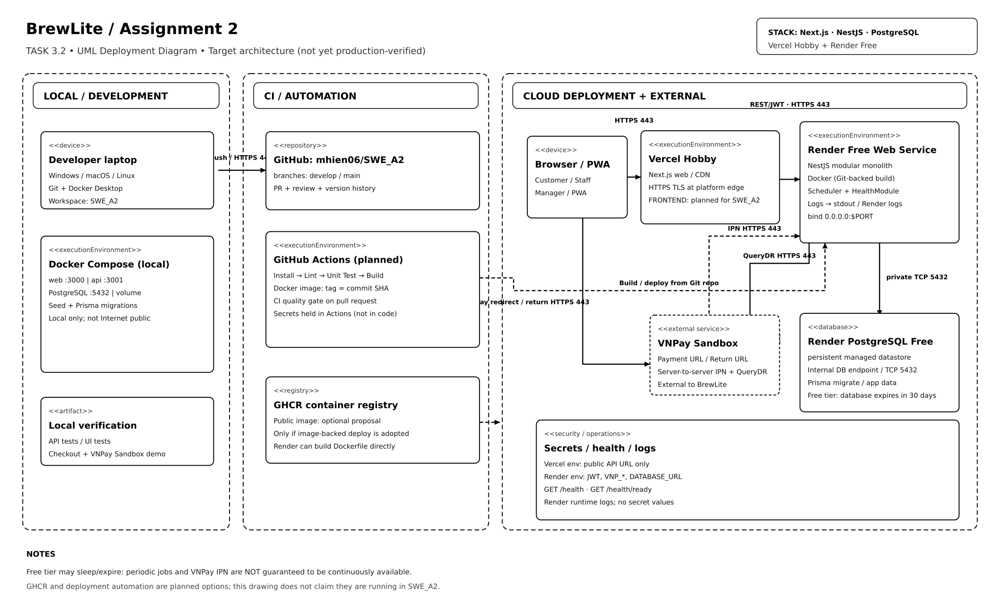

# Task 3.2 - UML Deployment Diagram: BrewLite (SWE_A2)

| Thuộc tính | Nội dung |
|---|---|
| Đồ án | BrewLite - Assignment 2, Công nghệ Phần mềm |
| Người phụ trách Task 3.2 | Trần Kim Xuyến (`@computerbotver2`) |
| Người review | Nguyễn Minh Hiển (`@mhien06`) |
| Issue | [#8 - Deployment Diagram](https://github.com/mhien06/SWE_A2/issues/8) |
| Nhánh dự kiến | `docs/task3-deployment` → `develop` |
| Căn cứ | [Task 3.1 - Kiến trúc do Khoa xây dựng](architecture.md); Assignment 2 PDF, mục 5.2 |
| Trạng thái | **Thiết kế đề xuất để review. Chưa xác nhận SWE_A2 đã deploy production.** |

## 1. Mục tiêu và nguyên tắc

Task 3.2 mô hình hóa cách các thành phần trong kiến trúc Task 3.1 được triển khai trên máy người dùng, môi trường local, CI và dịch vụ cloud. Bản thiết kế sử dụng **Vercel (Next.js/PWA)**, **Render (NestJS Docker)** và **PostgreSQL**; nền tảng được ưu tiên trong gói miễn phí cho mục đích học tập/phi thương mại. **VNPay Sandbox** là hệ thống bên ngoài BrewLite. Không tách microservice; không thêm Redis, Kubernetes, worker, message broker, dịch vụ tính phí hay tài khoản thanh toán thật.

Bản vẽ là **mục tiêu triển khai** cho SWE_A2, không phải bằng chứng hệ thống hiện đã hoạt động. Kết quả production URL, workflow runs và thông số dịch vụ thực tế sẽ được điền ở Task 5.3–5.4 sau khi triển khai và xác minh. Tránh dùng URL thật của đồ án BrewLite_A1 để tuyên bố SWE_A2 đã triển khai.

## 2. Tệp sơ đồ

- `docs/diagrams/sources/deployment-production.drawio` - nguồn draw.io chỉnh sửa được, 3 ranh giới rõ ràng.
- `docs/diagrams/exports/deployment-production.svg` - bản xuất SVG dùng trong Markdown/báo cáo.

## 3. Các node, execution environment và artifact

| Ranh giới | Node / môi trường | Artifact / nhiệm vụ | Tương ứng Task 3.1 |
|---|---|---|---|
| Thiết bị người dùng | Browser/PWA | Web app; Customer/Staff/Manager | §4.1, §4.2 Web App |
| Local | Laptop + Docker Desktop + Compose | `apps/web`, `apps/api`, Postgres local; test, migration, seed | §8.1; Task 5.2 |
| CI | GitHub repository và GitHub Actions | PR quality gate, build image theo SHA; logs | §8.2, §9; Task 4.4 / 5.3 |
| Registry (phương án) | GitHub Container Registry (GHCR) | Image Docker nếu pipeline chọn image-backed | §9 Docker; Task 3.2 PDF mục registry |
| Cloud frontend | Vercel Hobby, HTTPS/CDN | `apps/web` Next.js/PWA | §4.2 Web App |
| Cloud backend | Render Free Web Service, Docker | `apps/api` NestJS monolith; `Auth`, `Product`, `Cart`, `Order`, `Payment`, `Inventory`, `Loyalty`, `Scheduler`, `Health` | §4.2–§5, §7–§8 |
| Cloud DB | Render Postgres Free | PostgreSQL có lưu trữ quản lý độc lập API; Prisma Migrate | §4.2 DB, §8.1 |
| Ngoại vi | VNPay Sandbox | Redirect/Return URL, IPN (server-to-server), QueryDR | §4.1, §5 PaymentModule |

**Docker image & registry:** PDF yêu cầu thể hiện container registry. Sơ đồ đưa **GHCR là lựa chọn dự kiến**, không khẳng định đã cấu hình. Theo Render, backend **có thể tự build image từ Dockerfile** trong repo (Git-backed), không bắt buộc push lên GHCR. Nếu sau này 5.3 chọn phương án build/push GHCR và Render pull image, cần cập nhật mũi tên/quy trình trong sơ đồ cho khớp cấu hình thật.

## 4. Luồng kết nối, giao thức và cổng

| Từ → Đến | Giao thức/cổng | Ý nghĩa |
|---|---|---|
| Browser → Vercel | HTTPS / TCP 443 | Tải Next.js/PWA |
| Vercel-served frontend / Browser → Render API | HTTPS / TCP 443 (public endpoint) | REST/JSON, JWT Bearer |
| Render ingress → NestJS | HTTP nội bộ, port từ biến `$PORT`; service bind `0.0.0.0` | Render terminate TLS, proxy nội bộ đến app |
| NestJS → PostgreSQL | TCP 5432, **Render internal DB URL** | Prisma, migration, transaction |
| Browser ↔ VNPay Sandbox | HTTPS / TCP 443 | Chuyển hướng trang thanh toán; Return URL đưa về web |
| NestJS → VNPay Sandbox | HTTPS / TCP 443 | Tạo URL theo API / gọi QueryDR, xác minh phản hồi |
| VNPay Sandbox → NestJS | HTTPS / TCP 443 | IPN có chữ ký; backend kiểm tra trước khi cập nhật |
| Máy dev → GitHub / CI → service cloud | HTTPS / TCP 443 | Push/PR, build/deploy qua Git integration hoặc API; CI thuộc pipeline tương lai |

**Lưu ý:** Browser gọi API từ môi trường frontend; Vercel không nhất thiết proxy qua máy chủ Vercel. Không gắn IPN vào frontend; VNPay cần URL API public và đáng tin cậy. VNP_RETURN_URL phục vụ trình duyệt quay về, không dùng làm bằng chứng cập nhật `PAID`.

## 5. Cấu hình và bí mật

| Nơi lưu | Ví dụ biến | Nguyên tắc |
|---|---|---|
| Vercel | `NEXT_PUBLIC_API_BASE_URL` (tên dự kiến, khớp code thực tế) | Chỉ expose URL public; không lưu `VNP_HASH_SECRET` hay `JWT_SECRET` ở biến public |
| Render Web Service | `DATABASE_URL`, `JWT_SECRET`, `JWT_EXPIRES_IN`, `VNP_TMN_CODE`, `VNP_HASH_SECRET`, `VNP_PAY_URL`, `VNP_API_URL`, `VNP_RETURN_URL`, `WEB_ORIGIN`, `PAYMENT_ATTEMPT_TTL_MINUTES` | Cấu hình trên Render dashboard hoặc secret management; không commit giá trị thật |
| Local | `.env` không commit, `.env.example` ghi tên/giá trị giả | DB local khác DB cloud; local seed không được chạy vào production |
| GitHub Actions (khi làm Task 5.3) | Token/Deploy Hook nếu thực sự dùng | Dùng GitHub Secrets; không in token trong log, không đẩy vào PR từ fork thiếu tin cậy |

Task 3.1 dùng **15 phút** là hạn ORDER `PENDING`; mỗi payment attempt có TTL riêng không vượt hạn của Order. Thời hạn attempt 5 phút từng được bàn tới nhưng phải được nhóm duyệt trong nghiệp vụ; không hard-code 5 phút vào sơ đồ như quy tắc đã chốt của repo.

## 6. Health check, logs, migration và scheduler

- **Liveness:** `GET /health` kiểm tra app còn hoạt động, không phụ thuộc DB theo kiến trúc Khoa §8.3.
- **Readiness:** `GET /health/ready` kiểm tra PostgreSQL; dùng sau deploy hoặc kiểm tra smoke test.
- **Logs:** NestJS xuất structured JSON ra stdout, Render thu thập logs; không log mật khẩu/JWT/token/vnp_SecureHash. GitHub Actions lưu log build/check; Vercel có logs frontend.
- **Migration:** Prisma Migrate; chạy migration phù hợp trước bản ứng dụng mới, có kế hoạch rollback (Task 5.3). Database production không public trực tiếp; dùng Internal Database URL ở backend (cùng region và khả dụng theo plan).
- **Scheduler:** nằm trong tiến trình NestJS (không vẽ worker riêng). Xử lý đối soát `PENDING/UNKNOWN` bằng QueryDR, hết hạn đơn `PENDING` theo thời điểm (mỗi phút khi tiến trình hoạt động). Các transaction `TX1` (Tạo đơn), `TX2` (Xử lý kết quả thanh toán), `TX3` (Hủy đơn, hoàn nguyên liệu và điểm) đều ở NestJS/PostgreSQL, không thực hiện trong Vercel.
- **Chính sách hủy/điểm:** giữ theo Task 3.1 của Khoa: hủy hợp lệ trước pha, hoàn nguyên liệu đúng một lần, điều chỉnh/bù điểm BrewLite theo SRS; **không biến deployment diagram thành mô hình tự động Refund VNPay** khi repo hiện chưa chốt triển khai đó.

## 7. Hạn chế gói miễn phí và biện pháp kiểm thử

| Rủi ro | Thực tế dịch vụ | Cách ghi nhận/xử lý trong đồ án |
|---|---|---|
| Render Free ngủ khi không có request | Web service spin down sau ~15 phút idle, khởi động lại khi nhận request; có độ trễ | Demo cần kiểm tra cold start; **scheduler trong API không chạy trong lúc service ngủ**; việc hết hạn 15 phút chỉ có hiệu lực khi API đang hoạt động và xử lý bù sau khi thức dậy |
| IPN đến khi backend ngủ | Có nguy cơ chậm/lỗi/timeout | Phải thử IPN thật trên URL public và đối soát QueryDR khi API hoạt động. **Không hứa IPN tức thời/độ tin cậy 24/7** với Render Free |
| Render PostgreSQL Free | Có dữ liệu persistent riêng service nhưng DB Free **hết hạn sau 30 ngày**, 1 GB theo chính sách công bố | Lưu ý ngày tạo DB; chuẩn bị backup/seed trước ngày nghiệm thu; không coi free DB là hạ tầng production lâu dài |
| Render Free service filesystem | Ephemeral; file ghi local không bền | Không lưu DB/file tải lên ở disk web service; dùng PostgreSQL |
| CI/CD và GHCR | Chưa được chứng minh đã cấu hình trong SWE_A2 | Task 4.4/5.3 cần PR, workflow, image tag (SHA), kết quả deploy và rollback; diagram để ở trạng thái dự kiến |
| Vercel Hobby | Miễn phí cho cá nhân/phi thương mại, có giới hạn tài nguyên | Sử dụng đúng mục đích đồ án, không tuyên bố khả năng mở rộng thương mại |

Dẫn chứng chính sách: [Render Free](https://render.com/docs/free), [Render Docker](https://render.com/docs/docker), [Render existing image / GHCR](https://render.com/docs/deploying-an-image), [Vercel Hobby](https://vercel.com/docs/plans/hobby), [GitHub Packages](https://docs.github.com/en/billing/concepts/product-billing/github-packages). Đã tra cứu vào 15/11/2026; các mức giới hạn có thể thay đổi.

## 8. Đối chiếu từng tiêu chí Task 3.2 trong đề

| Yêu cầu theo PDF | Vị trí trong bộ bàn giao | Trạng thái bản thiết kế |
|---|---|---|
| Thiết bị chạy browser/PWA | Sơ đồ node Browser; §3 | Đã mô tả |
| Next.js/CDN | Vercel node; §3 | Đã mô tả |
| NestJS service/container | Render node; §3 | Đã mô tả |
| PostgreSQL + persistent storage | Render Postgres; §3, §6 | Đã mô tả (đang lựa chọn DB cloud cho A2) |
| Container registry + deployment platform | GHCR dự kiến, GitHub Actions, Vercel, Render; §3, §7 | Đã mô tả, cần xác nhận phương thức deploy ở Task 5.3 |
| HTTPS, network nội bộ, cổng | Các mũi tên trong sơ đồ; §4 | Đã mô tả |
| Secret/env, health, log | Node operations; §5–§6 | Đã mô tả |
| Ranh giới Local / CI / Production | 3 vùng nét đứt trong sơ đồ; §3 | Đã mô tả |
| Phản ánh **đúng thực tế** | URL, DB, registry, workflow, health endpoints thực tế | **Chưa xác minh production A2** |
| Liên hệ 3.1 và source code | §3, §6, §9 | Đã liên hệ kiến trúc 3.1; source code Task 4–5 chưa có để truy vết thực tế |

**Kết luận:** Bộ tài liệu đủ thành phần *thiết kế* Task 3.2 để Xuyến gửi review. Chỉ nên kết luận **Task 3.2 đã nghiệm thu** khi reviewer kiểm tra sơ đồ, nhất quán với Task 3.1, thông tin hạ tầng thực tế đã xác minh, và PR merge vào `develop`.

## 9. Liên hệ công việc sau Task 3.2

- Task 4: Khởi tạo `apps/web`, `apps/api`, cấu hình CI; sau đó cập nhật tên biến/cổng chính thức nếu thay đổi.
- Task 5.2: `docker-compose.yml` chạy local 3 dịch vụ; seed/migration và test health endpoints.
- Task 5.3: Chọn Git-backed Dockerfile (đơn giản) hoặc GHCR image-backed (cần workflow push image); chạy CI quality gates, smoke test, rollback.
- Task 5.4: Bổ sung URL frontend/API thật, log minh chứng deploy, README, release notes, demo; xác nhận không public DB và không lộ secret.

## 10. Nguồn và giới hạn đánh giá

1. [Task 3.1 của Khoa trên `develop`](https://github.com/mhien06/SWE_A2/blob/develop/docs/architecture/architecture.md), mục §4–§9.
2. [Issue Task 3.2 của Xuyến](https://github.com/mhien06/SWE_A2/issues/8).
3. File PDF người dùng cung cấp: `Assignment2-BrewLite`, mục 5.2, trang 5 theo số trang tệp PDF.
4. Các trang tài liệu chính thức về giới hạn dịch vụ miễn phí được dẫn ở §7.

Tài liệu này **không** xác nhận SWE_A2 đã có ứng dụng/CI/production chạy được và không thay đổi nội dung Task 3.1. Những điểm trong §11 của Task 3.1 vẫn cần xác nhận trước khi code.
